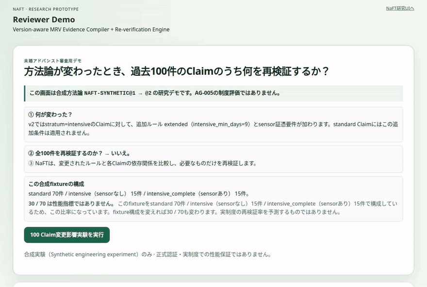
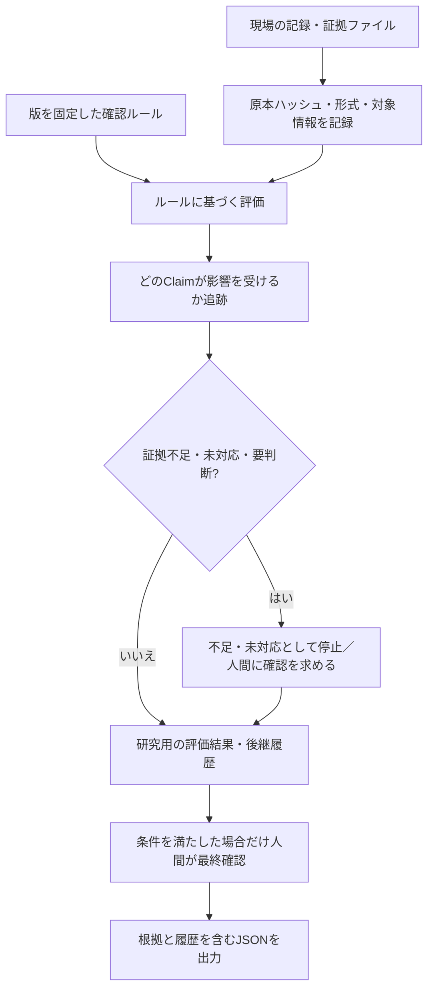

# NaFT｜ルールが変わっても、証拠を見失わない。

農業の温室効果ガス削減を記録・確認する人が、確認ルールや提出資料の変更で迷わないように、**見直すべき案件とその理由**を示す研究用ツールです。

[](https://github.com/Takzin1/NaFT/actions/workflows/ci.yml) [](LICENSE)

**▶ 審査員向けデモ（ブラウザですぐ試す）**：[100件の変更影響デモ](https://takzin1.github.io/NaFT/naft-app.html#/reviewer-demo) ／ [日本語デモ](https://takzin1.github.io/NaFT/gikuten.html#/reviewer-demo) ／ [研究・データ画面](https://takzin1.github.io/NaFT/naft-app.html#/gx-data)
操作手順：[60秒デモガイド](docs/demo-script.md)



🎬 **デモGIF**：Reviewer Demo の60秒フロー（100 Claim変更影響実験 → 再検証30件／影響なし70件 → 代表Claim MITOU-086 の再検証理由 → 人間判断のstale化）。

## 解決する課題

排出削減の記録を測定・報告・検証する仕事（MRV）では、方法論（確認ルール）や証憑（根拠となる記録）が更新されます。
そのとき、**どの申請・評価候補（Claim）を再検証すべきか**が分からないと、見落としや不要な全件確認につながります。
NaFTは、変更と根拠のつながりを記録し、再確認する対象と理由を追えるようにします。

## NaFTがやること

- **証拠の同一性と由来を記録**：ファイルのSHA-256（内容を照合する指紋）、メタデータ、対象活動・期間・ルール版との対応を保持する。ハッシュ一致は発行元の真正性までは証明しません。
- **確認ルールを版ごとに管理**：Methodology Pack（版付きのルール定義）を固定し、どの版を使った評価かを追跡する。
- **変更の影響を絞り込む**：方法論・証拠・係数・圃場・活動の５種類の変更を比較し、再検証候補、依存関係、旧版とのつながりを示す。
- **判断を人に戻す**：証拠不足や未対応条件で自動確定せず、明示的な例外判断と最終確認を要求する。入力やルールの変更後は以前の人間判断を再利用しない。
- **結果を再現できる形で出力**：入力・ルール・判定理由を結び付けたJSONと依存関係グラフを作り、合成データのデモと公開データの研究画面を提供する。

詳細：[アーキテクチャ](docs/architecture.md) ／ [データモデル](docs/data-model.md) ／ [人間の判断](docs/human-in-the-loop.md)

## やらないこと・限界

- **正式な削減量の算定・認証・クレジット発行はしません。** 認証済み計算結果の`result`は`null`、研究用出力の`formal_certification`は`false`です。
- 未登録の制度版・未対応のルール・証拠不足は`UNKNOWN`、`CONFIG_REQUIRED`、`UNSUPPORTED`、`EVIDENCE_REQUIRED`などの状態で止め、成功を装いません。AG-005の`3.1-reference`は旧版の参考実装であり、現行版の完全対応ではありません。AG-004は実行可能な制度ルールとして未実装です。
- 写真の内容理解、センサー校正、圃場の地理的な真正性判定、外部審査機関の承認、実運用の認証・権限管理・複数利用者間の安全な隔離は未実装です。
- 100件のデモは**架空のルールと合成データ**です。「30件を再確認、70件は影響なし」はサンプルの構成による結果であり、実務での**70％工数・費用削減実績ではありません**。
- 研究用データの原本と派生統計には個別の利用条件があります。ソフトウェアのMITライセンスだけで第三者データの再配布が許可されるわけではありません。

詳細：[既知の制約](docs/known-limitations.md) ／ [方法論の出典・版](docs/methodology-sources.md) ／ [権利・法務](docs/legal-risk-map.md)

## クイックスタート

Node.js **20以上**、Python 3、Bashが必要です。アプリ本体は静的なHTML/JavaScriptで、ビルドやnpm依存パッケージのインストールは不要です。

```bash
git clone https://github.com/Takzin1/NaFT.git
cd NaFT

npm test
# 同じ検査を直接実行する場合
bash tests/run.sh

# ローカル画面を開く（別ターミナル）
python3 -m http.server 8000
```

ブラウザで `http://localhost:8000/naft-app.html#/reviewer-demo` を開き、「100 Claim変更影響実験を実行」を押してください。Chrome/Chromiumを備えた環境では、別途 `bash scripts/ci-browser-smoke.sh` で実ブラウザの画面検査も実行できます（GitHub ActionsではNode.js 24を使用）。

詳細：[デモ手順](docs/demo-script.md) ／ [開発時の確認事項](docs/pr-checklist.md)

## 入口の一覧

| ファイル | 役割 | 誰におすすめか |
| --- | --- | --- |
| [`index.html`](index.html) | `naft-app.html`へ転送する入口。URLの`#`以降も引き継ぐ | 通常の訪問者 |
| [`naft-app.html`](naft-app.html) | ６段階の研究ワークフロー、Reviewer Demo、GX Data Atlasなどを表示 | **審査員は`#/reviewer-demo`から**／実務者 |
| [`gikuten.html`](gikuten.html) | 技育展向けの日本語デモ入口 | 日本語で操作したい審査員 |
| [`gikuten-pitch.html`](gikuten-pitch.html) | 技育展2026向けの説明スライド | 非技術系審査員・プレゼン |

**審査用の最短ルート**：まず[Reviewer Demo](https://takzin1.github.io/NaFT/naft-app.html#/reviewer-demo)で100件の合成変更実験を動かし、次に代表Claimの「なぜ影響したか」を確認してください。

## 全国47都道府県の土壌GIS証拠レジストリ（P76）

全国47県・60,863ポリゴンの**原本由来・非座標集計**を[GX Data Atlas](naft-app.html#/gx-data)に統合。県別のZIP SHA-256、行政属性の要照合、未報告の品質項目を一覧できる研究用ダッシュボードです。全国スナップショットを静的JSとして同梱し、画面表示時に外部APIや原本ZIPを取得しません。公式配布元との原本同一性・個別データ再配布許諾は未検証で、農地面積や認証済みクレジット量を示しません。詳細：[P76全国レジストリの監査](docs/p76-national-soil-evidence-registry-ja.md)。

## 品質・再現性

| 検査 | リポジトリで確認できる範囲 |
| --- | --- |
| 中核の回帰検査 | 既存182、Compiler354、合成変更実験10、Impact Proof619の**計1,165アサーション**（[記録](docs/test-report.md)） |
| 変更の見逃し検査 | 614件の決定論的な反例ケース。**試験範囲内**の見逃し0件、安全側の追加再検証107件（[分析](docs/impact-soundness.md)） |
| 画面の検査 | GitHub Actions上のheadless ChromeでReviewer Demo、６つの画面、ファイル同一性検査、役割ごとの操作と出力、日本語デモを確認 |
| 再現性と改変検出 | 正規化JSON、SHA-256、原本のローカル照合、独立再計算、生成レポートとGitの差分確認 |
| 実運用との区別 | 上記は工学上の検査であり、現場の排出削減量、審査機関の受入れ、運用時の精度を証明するものではない |

`npm test` / `bash tests/run.sh`はコア・静的・セキュリティ検査を実行します。**実ブラウザ検査は別コマンド**で、CIからも実行します。合成テストと実観測データの品質評価を混同しません。

詳細：[全テスト内容](docs/test-report.md) ／ [反例検査の境界](docs/impact-soundness.md) ／ [セキュリティ](docs/security-checklist.md)

## アーキテクチャ



`src/mrv-core.js`は共通の記録・ハッシュ処理、`src/methodology-packs.js`は版付き定義、`src/mrv-compiler.js`は評価・差分・依存追跡、`src/compiler-session.js`は実行履歴と人間判断、`src/mrv-ui.js`は画面を担当します。

詳細：[設計図・処理の契約](docs/architecture.md) ／ [JSONの構造](docs/data-model.md)

## ドキュメント索引

**[▶ docs/README.md — 利用者別・機能別の索引](docs/README.md)**

方法論の根拠、研究データの出典と原本照合、検証コード、既知の限界、貢献方法はここから探せます。旧READMEの詳細な研究開発ログは[保存版](docs/readme-research-log-2026-11-03.md)に移しました。

## 関連リポジトリ

[**NaFT-IEEE_Climate_Hackathon_Edition**](https://github.com/Takzin1/NaFT-IEEE_Climate_Hackathon_Edition)は、IEEE ClimateChain向けの英語デモ・研究派生版です。公開Sepoliaのハッシュ継承記録を参照する機能などを含みますが、**ブロックチェーンの記録は環境測定の正しさや認証を証明しません**。本リポジトリは日本語のMRV研究基盤・出典監査・GXデータ表示を含む本体で、IEEE版の機能をすべて同一実装として扱いません。

詳細：[日本語版への移植範囲](docs/ieee-japanese-port-2026-10-25.md) ／ [未移植機能の整理](docs/ieee-ja-next-stage-roadmap-2026-11-02.md)

## ライセンス・作者

- **ライセンス**：[MIT License](LICENSE)（`Copyright (c) 2026 NaFT Project (PoC)`）。研究用PoCであること、実際の決済・交換可能なトークン・認証済みクレジット取引には事前の法的検討が必要なことをLICENSEに明記しています。
- **開発・管理**：[Takzin1](https://github.com/Takzin1)。[技育展向け資料](gikuten-pitch.html)には弓田隆仁（福島大学大学院）の表記があります。
- **ご注意**：MITは本リポジトリのソフトウェア・付随ドキュメントの条項です。JAXA、官公庁、研究者等の第三者原データとその派生物の利用条件は別途確認してください。研究用の試作であり、公式なクレジット認証製品ではありません。

## English summary

- NaFT helps climate-project operators identify which evidence-backed claims need review after rules or inputs change.
- It pins evidence and rule versions, traces dependencies, and produces reproducible research JSON.
- Missing evidence and unsupported institutional rules block automated approval.
- The 100-claim demo and 614 adversarial cases use synthetic scenarios, not certified farm reductions.
- This is an MIT-licensed research prototype; see the browser demo, tests, and documentation above.
